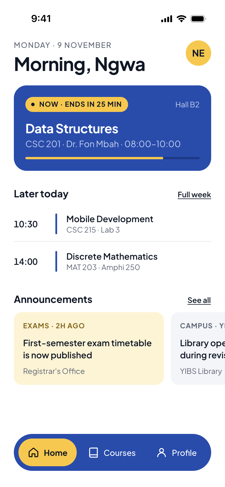
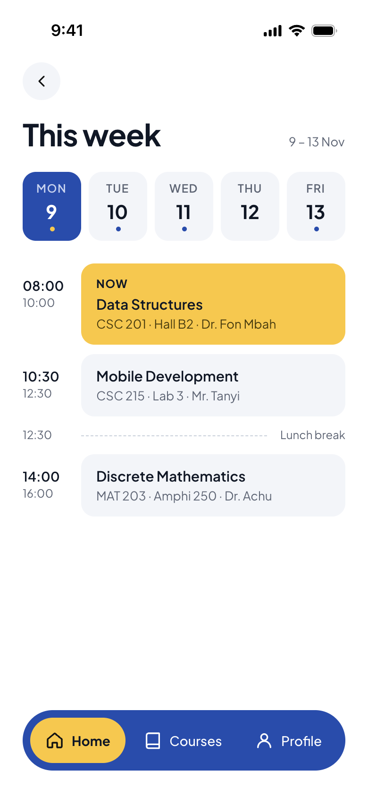
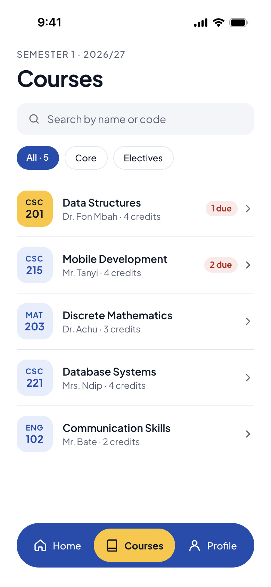
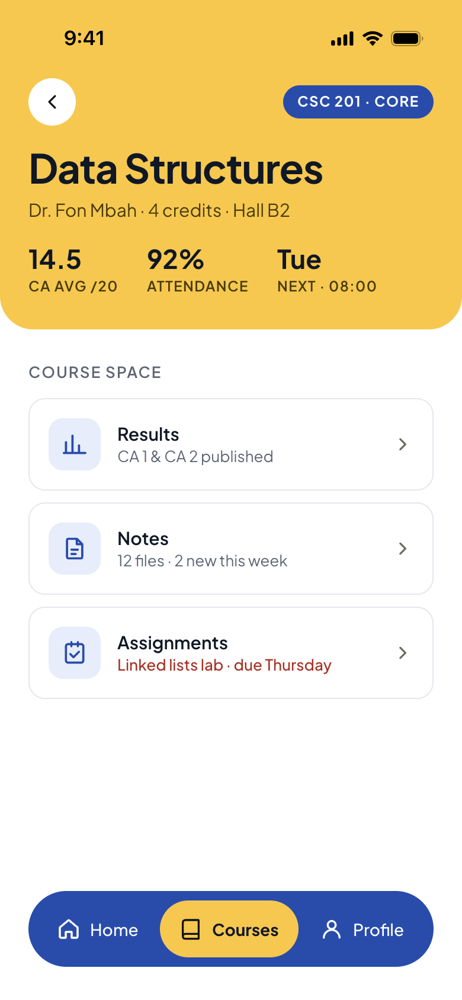
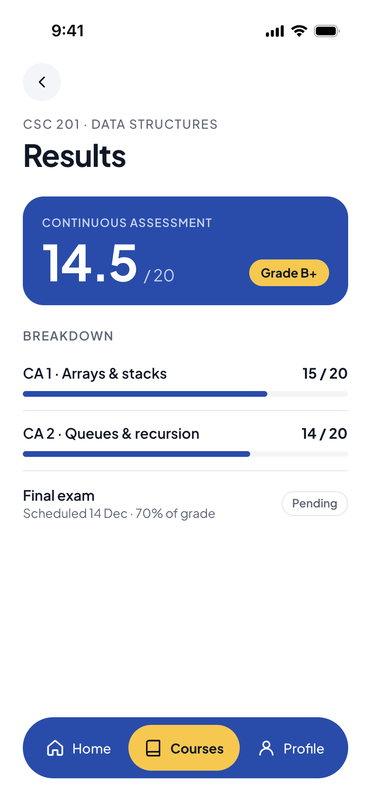
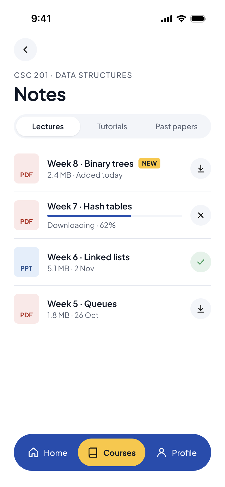
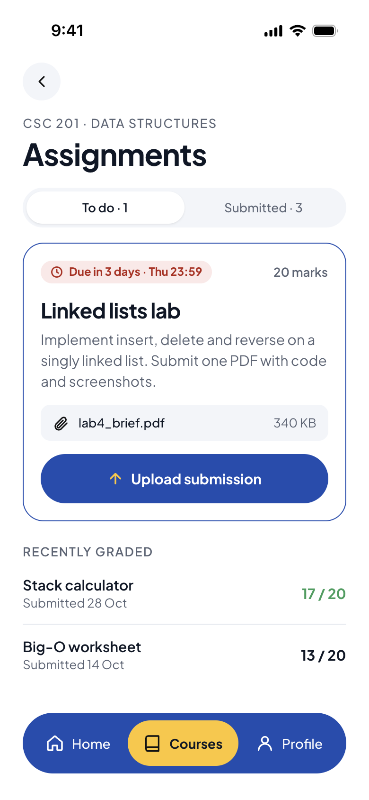
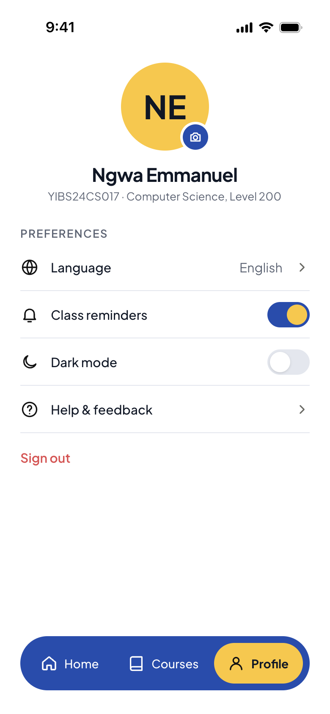
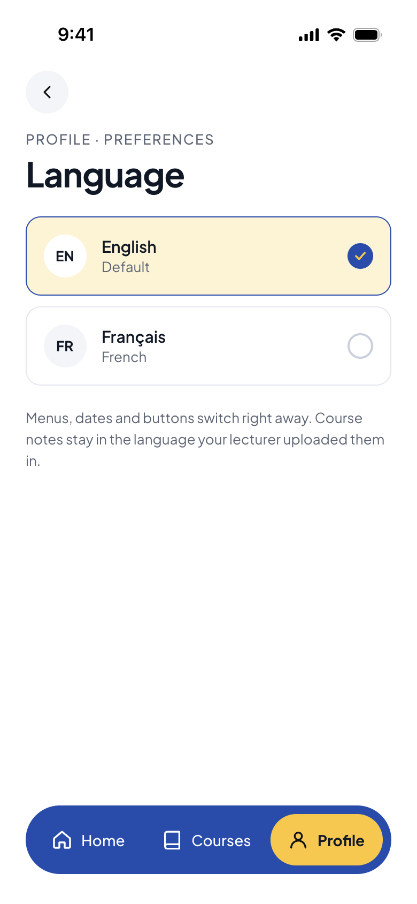
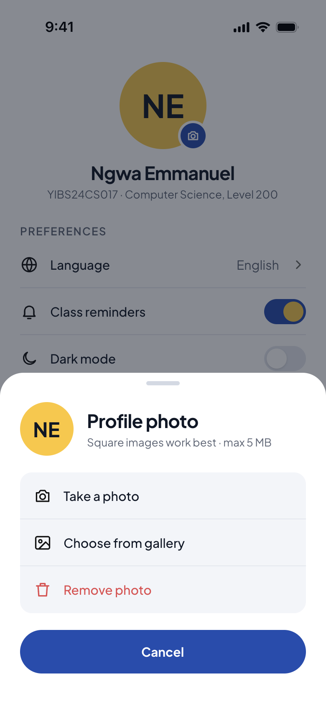

# Design

UI design for **Campus Companion**. Each screen below is the reference for one or more student issues.
All tokens live in [`constants/theme.ts`](../constants/theme.ts). Use the tokens instead of hard-coded values.

## Screens

| #   | Screen                                                | Tab     | Preview                                                 |
| --- | ----------------------------------------------------- | ------- | ------------------------------------------------------- |
| 01  | Home: class happening now, later today, announcements | Home    |            |
| 02  | Week timetable (from "Full week" on Home)             | Home    |  |
| 03  | Courses list: search + filters                        | Courses |         |
| 04  | Course detail: hub for Results / Notes / Assignments  | Courses |   |
| 05  | Results                                               | Courses |         |
| 06  | Notes: download states                                | Courses |           |
| 07  | Assignments: upload submission                        | Courses |     |
| 08  | Profile: settings                                     | Profile |         |
| 09  | Language picker                                       | Profile |        |
| 10  | Change photo (bottom sheet)                           | Profile |    |

Screens are exported at 2x for a 390 × 844 pt iPhone frame.

## Tokens

### Colour (light)

YIBS blue is the primary colour and YIBS yellow the secondary. Neutrals are tinted toward the blue.

| Token                                  | Hex                               | Use                                                               |
| -------------------------------------- | --------------------------------- | ----------------------------------------------------------------- |
| `primary` / `onPrimary`                | `#1B4DB1` / `#FFFFFF`             | Buttons, tab bar, "now" class card, results card, selected states |
| `primaryDeep`                          | `#123A8C`                         | Track behind progress on blue cards                               |
| `primarySoft`                          | `#E6EDFB`                         | Course code tiles, icon tiles                                     |
| `onPrimaryMuted`                       | `#C5D3F2`                         | Secondary text on blue                                            |
| `secondary` / `onSecondary`            | `#FFC629` / `#0E1726`             | Active tab pill, current class pill, course header, avatar        |
| `secondarySoft` / `secondaryText`      | `#FFF4D1` / `#8A6400`             | Highlighted announcement, selected option                         |
| `background`                           | `#FFFFFF`                         | Screen background                                                 |
| `surface`                              | `#F3F5FA`                         | Inputs, inactive chips, segmented control                         |
| `text`                                 | `#0E1726`                         | Main text                                                         |
| `textMuted`                            | `#5B6475`                         | Secondary text, meta                                              |
| `border`                               | `#E3E7EF`                         | Dividers, outlined cards and chips                                |
| `danger` / `dangerText` / `dangerSoft` | `#E5484D` / `#B42318` / `#FDE8E8` | Due dates, remove, sign out                                       |
| `success` / `successSoft`              | `#2F9E5B` / `#E3F3E9`             | Good grades, downloaded                                           |

A dark palette with the same keys is in `colors.dark`.

### Typography: Plus Jakarta Sans (Google Fonts)

| Variant    | Size / line height | Weight   | Example                |
| ---------- | ------------------ | -------- | ---------------------- |
| `display`  | 52 / 56            | Bold     | `14.5` on Results      |
| `h1`       | 32 / 38            | Bold     | Screen titles          |
| `h2`       | 22 / 28            | Bold     | Card titles            |
| `h3`       | 17 / 22            | Bold     | Section headings       |
| `body`     | 15 / 22            | Regular  | Body text              |
| `bodyBold` | 15 / 22            | SemiBold | List row titles        |
| `caption`  | 13 / 18            | Regular  | Meta text              |
| `overline` | 13 / 18, uppercase | Medium   | `SEMESTER 1 · 2026/27` |
| `label`    | 12 / 16, uppercase | Bold     | Pills and badges       |

### Spacing and radius

- Spacing: `xs 4 · sm 8 · md 12 · lg 16 · xl 24 · xxl 32`. Screen side padding is `xl` (24).
- Radius: `sm 8 · md 14 · lg 22 · full 999`

## Patterns

- **Tab bar**: floating blue pill, 64 high, 24 from the sides, 28 from the bottom. Active tab is a yellow pill with icon + label.
- **Back button**: 40 × 40 circle on `surface`, chevron icon.
- **List rows**: fixed-width leading slot (icon or tile), flexible text, trailing chevron or action; 1px `border` divider.
- **Switch**: on = blue track with yellow thumb; off = `border` track with white thumb.
